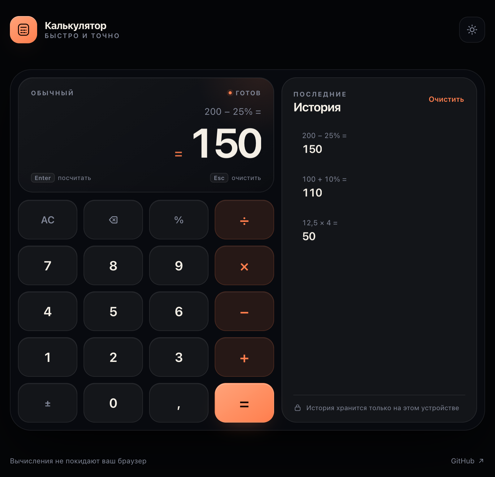
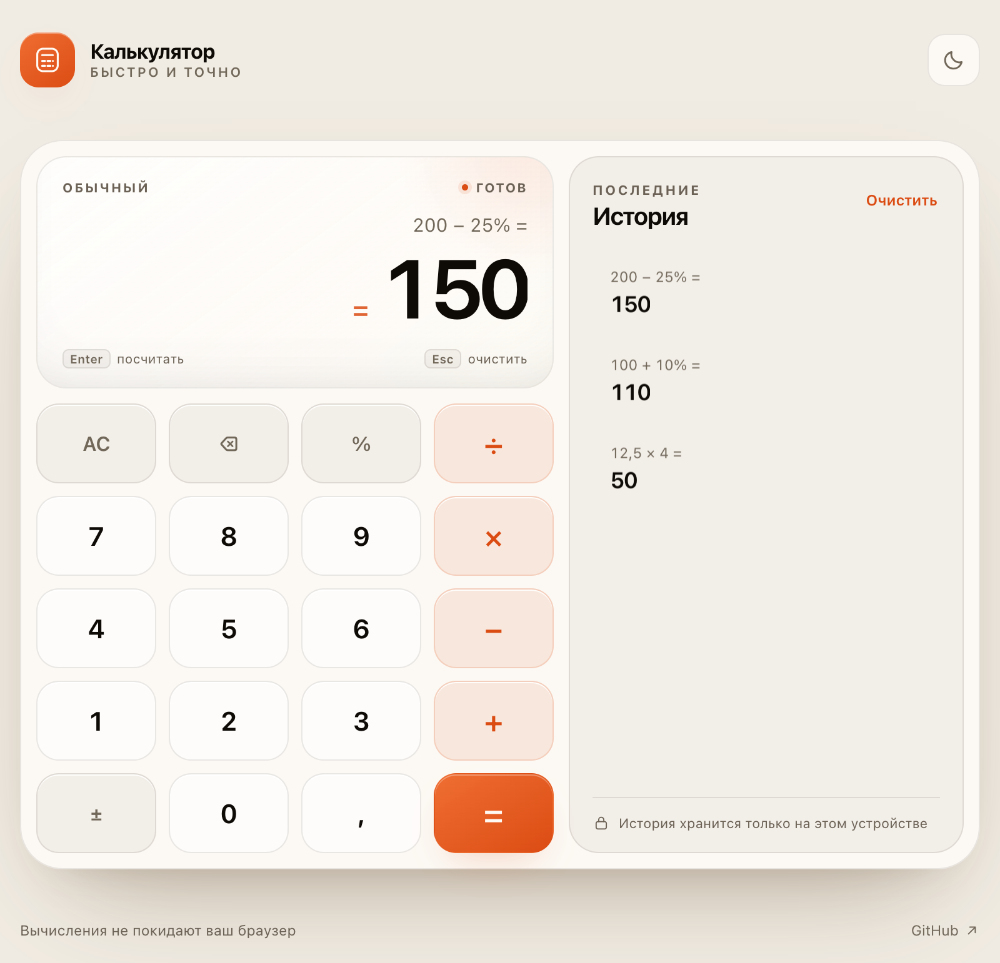

# Калькулятор

Калькулятор с графическим интерфейсом: аккуратная тёмная и светлая темы, история вычислений, поддержка клавиатуры и офлайн-режим. Без фреймворков и зависимостей.

[](https://s1lentyk.github.io/calculator/)



## Возможности

- базовые операции, степени, скобки и проценты;
- вычисление выражений с учётом приоритета операторов;
- живой предпросмотр результата до нажатия `=`;
- история последних 30 вычислений — хранится локально и восстанавливается после перезагрузки;
- возврат к результату из истории одним нажатием;
- полная поддержка клавиатуры;
- светлая и тёмная темы с запоминанием выбора;
- адаптивная вёрстка для компьютеров и телефонов;
- установка как PWA и работа без интернета;
- аккуратные ошибки: деление на ноль, незавершённое выражение и т. п.



## Запуск

Самый простой способ — открыть [живую демонстрацию](https://s1lentyk.github.io/calculator/).

Для локального запуска нужен любой статический сервер (ES-модули и service worker не работают через `file://`):

```bash
git clone https://github.com/S1LENTYK/calculator.git
cd calculator
python3 -m http.server 8000
```

Откройте <http://localhost:8000>.

## Клавиатура

| Клавиша | Действие |
| --- | --- |
| `0`–`9` | ввод цифр |
| `,` или `.` | десятичная запятая |
| `+`, `-`, `*`, `/` | арифметические операции |
| `%` | процент |
| `Enter` или `=` | вычислить |
| `Backspace` | удалить последний символ |
| `Esc` или `Delete` | очистить |

Скобки и степень можно вводить с клавиатуры: `(`, `)` и `^`. Например, `(2 + 3) * 4` или `2 ^ 10`.

### Проценты

Проценты работают как в обычном калькуляторе:

| Выражение | Результат |
| --- | --- |
| `200 + 10%` | `220` |
| `200 − 10%` | `180` |
| `200 × 10%` | `20` |
| `50%` | `0,5` |

## Тесты

Логика вычислений покрыта тестами на встроенном тест-раннере Node.js:

```bash
npm test
```

Тесты проверяют приоритет операторов, унарный минус, степени, проценты, округление, форматирование и обработку ошибок.

## Структура

```text
calculator/
├── index.html              # разметка интерфейса
├── styles.css              # темы и адаптивная вёрстка
├── src/
│   ├── engine.js           # токенизатор, парсер и вычисление выражений
│   └── app.js              # состояние, ввод, история, темы, PWA
├── tests/engine.test.js    # тесты вычислительного движка
├── icons/                  # иконки приложения
├── manifest.webmanifest    # PWA-манифест
├── sw.js                   # офлайн-кэширование
```

Вычислительное ядро не использует `eval()`: выражение разбирается рекурсивным спуском в AST, проценты и приоритет операторов обрабатываются явно.

## Лицензия

[MIT](LICENSE) © 2026 S1LENTYK
